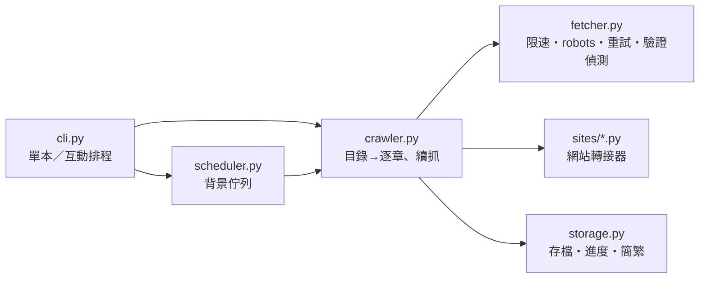

# bookcrawler

可擴充、有禮貌的書籍爬蟲套件。核心負責抓取、存檔與排程，每個網站只要寫一個小小的轉接器（adapter）。
內建[中文維基文庫](https://zh.wikisource.org/)（公有領域古典作品）的轉接器作為範例。

*A polite, pluggable book crawler: rate limiting, robots.txt compliance, crash-safe resume, and a site-adapter architecture.*

## 特色

- **轉接器架構**：網站的解析規則和核心分開。新增網站＝新增一個類別，核心不用改
- **有禮貌**：請求之間隨機間隔，不少於 robots.txt 的 `Crawl-delay`；連續抓一段會長休息；User-Agent 可設定聯絡方式
- **遵守 robots.txt**：被禁止的網址一次都不會請求（依 RFC 9309 處理 4xx／5xx）
- **遇到機器人驗證就停**：偵測 Cloudflare 等驗證頁或 403 時立即停止，不重試、不繞過
- **可靠的重試**：逾時、429、5xx 會重試，等待時間指數成長，並遵守 `Retry-After`
- **當機也不會壞檔**：進度檔記錄輸出檔長度，續抓時先截回，章節不會重複或寫一半
- **連載友善**：用上次最後一章的網址在新目錄中對位，作者更新後再跑一次只抓新章節
- **中文編碼**：依標頭、`<meta charset>`、UTF-8、GB18030、Big5 依序判斷；可選 OpenCC 簡繁轉換
- **離線測試**：解析器只吃 HTML 字串，用存下來的網頁測；抓取與續抓用本機假網站做端對端測試

## 安裝

```bash
pip install -e .            # 或 pip install -e ".[opencc]" 以啟用簡繁轉換
```

需要 Python 3.10 以上。

## 使用

```bash
# 抓一本（貼目錄頁或任一章的網址都可以）
python -m bookcrawler "https://zh.wikisource.org/wiki/西遊記"

# 先試抓 3 章；再執行同一個指令會從第 4 章接續
python -m bookcrawler "https://zh.wikisource.org/wiki/西遊記" --max-chapters 3

# 互動模式：貼網址加入背景排程，list 查看，q 離開（下次開啟自動接續）
python -m bookcrawler

# 其他選項
python -m bookcrawler --help
python -m bookcrawler --sites
```

建議設定帶有聯絡方式的 User-Agent（[Wikimedia 的要求](https://meta.wikimedia.org/wiki/User-Agent_policy)）：

```bash
export BOOKCRAWLER_UA="bookcrawler/0.1 (you@example.com)"      # PowerShell：$env:BOOKCRAWLER_UA = "..."
```

輸出在 `output/`，進度與排程在 `state/`。

## 架構



```
bookcrawler/
├── fetcher.py      HTTP：限速、robots.txt、重試、機器人驗證偵測、編碼判斷
├── crawler.py      抓一本書的流程與斷點續抓
├── storage.py      輸出檔、原子寫入的進度檔、OpenCC 轉換
├── scheduler.py    背景執行緒＋持久化佇列
├── cli.py          命令列介面
└── sites/
    ├── base.py         SiteAdapter 介面
    └── wikisource.py   中文維基文庫
tests/
├── samples/        存下來的網頁（離線測解析器）
├── server.py       本機假網站
└── test_*.py
```

## 新增網站

繼承 `SiteAdapter`，實作四個方法，加上 `@register`：

```python
from bookcrawler.models import Book, Chapter, ChapterLink
from bookcrawler.sites import register
from bookcrawler.sites.base import SiteAdapter


@register
class ExampleAdapter(SiteAdapter):
    name = "example"
    domains = ("books.example.org",)

    def book_key(self, url): ...           # 同一本書的唯一識別（存進度用）
    def toc_url(self, url): ...            # 從任一章的網址算出目錄頁
    def parse_toc(self, html, url): ...    # -> Book(title, url, author, chapters=[ChapterLink...])
    def parse_chapter(self, html, url, link): ...   # -> Chapter(title, paragraphs)
```

放在 `bookcrawler/sites/` 並在 `sites/__init__.py` 匯入，或放在 `local_sites/` 資料夾由 CLI 自動載入
（`local_sites/` 已列入 `.gitignore`，適合不公開的個人轉接器）。

請只用在允許爬取的網站，並遵守該網站的服務條款與著作權。

## 測試

```bash
python -m unittest -v
```

GitHub Actions 會在 Ubuntu 與 Windows、Python 3.10／3.12／3.13 上執行。

## 授權

MIT
